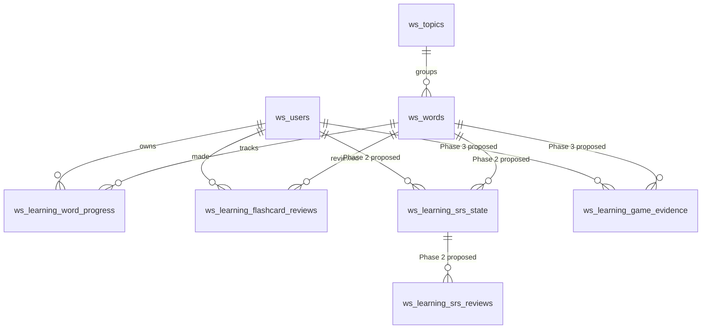

# WordSky Learning Data Architecture — ADR-001 (2026-10-26)

**Status:** Phase 0 proposed/implemented contract; Phase 1 account-first Dashboard on isolated Preview only. Phase 2/3 schema are **design proposals, not deployed migrations**.

## Source of truth & observed state

Verified against `db/schema.sql`, `lib/learning-progress.js`, `public/learn.html`, `public/ux10-progress.js`, and read-only Supabase schema inspection. Existing tables: `ws_users`, `ws_topics`, `ws_words`, `ws_learning_flashcard_reviews`, `ws_learning_word_progress`, `ws_solo_runs`, `ws_runs`, `ws_participants`, `ws_rounds`. The Learning Progress tables exist in the **isolated Preview database**, **not Production** as checked on 2026-10-26. Vercel Production READY does not imply schema readiness.

**Core rule:** `ws_users.id` is the only account identity; `ws_words.id` is the server vocabulary identity. Never use browser `topic:english` keys as a database UUID, and never conflate a multiplayer guest participant with a registered account.

## Phase 1 — Account Progress (implemented contract)

| Data | Owner | Identity / invariant | State |
|---|---|---|---|
| Account | `ws_users` | server-issued UUID; session via httpOnly cookie | existing |
| Vocabulary | `ws_words` + `ws_topics` | server-issued UUID; only enabled rows offered | existing |
| Flashcard history | `ws_learning_flashcard_reviews` | immutable per-review event; `user_id`, `word_id`, `remembered`, timestamp | Preview only |
| Current Flashcard decision | `ws_learning_word_progress` | PK `(user_id,word_id)`; latest remembered + count | Preview only |
| Browser Flashcards | localStorage `wordsky_vocab_v2`, `wordsky_learned` | topic+lowercase English, **browser-specific** | existing |

The only backend routes are `GET /api/learning/flashcards/catalog` (account-authenticated enabled vocabulary), `GET /api/learning/flashcards/progress` (only the authenticated account's review decisions) and `POST /api/learning/flashcards/reviews` (explicit UUID + boolean, authenticated account).

**Dashboard selection:** When `loadAccount()` succeeds for a player, the Dashboard's four main counters, ring, topic filters, word library, and action buttons use the **server catalog and that player's reviewed decisions**. Denominator is all enabled catalog words; *unreviewed* words count as “chưa nhớ/cần ôn,” not as recorded failed reviews. The separate account review section explicitly displays **reviewed count**. For guest, 503, or no connection, main Dashboard falls back to the browser-only deck and is labelled accordingly. Never display an unauthenticated local 0 as “server account progress.” A network error is not proof of an empty account.

**Edits:** Account-mode buttons verify session again and send account reviews; they must not rewrite browser storage as a side effect. Guest/browser-mode buttons use localStorage only. Flashcard's existing UI persists locally first and posts a server review only for an exact unambiguous catalog match. The browser account's old learning state is **never auto-imported**. Manual import has a confirmation and skips unmatched words and *all* UUIDs with existing server decisions (including `false`). A failed request does not claim server success; retry is an explicit user action. Login/logout or tab-focus must not post under a switched user: new review POSTs include an optional `expected_actor_id` pinned to the account that initiated the action, and the backend rejects mismatches with HTTP 409. The cookie remains the only trusted source of identity.

**Limitations:** The catalog is capped at 5,000 enabled words; beyond this threshold backend returns 503. Later phases can paginate. The current review API appends a new review event every accepted POST; retry after uncertain network failure may increment review_count again. A future change must introduce idempotency keys before automated retries/offline queues.

**Privacy and security:** User identity is derived exclusively from the server-verified WordSky cookie; the API does not trust a client-supplied `user_id`. The Supabase public-schema learning tables have RLS enabled and no direct `anon`/`authenticated` Data API grants; the WordSky Node backend uses a privileged DB connection. Do not open RLS grants to bypass API auth. Returning 503 for absent Production tables is fail-closed, not a reason to modify Production without approval.

## Phase 2 — Smart Review / SRS (design only)

**Not deployed.** Decide scheduler first; compare SM-2 simplicity versus FSRS complexity and the required quality/retention data before picking. The user should be asked for a recall rating rather than equating “Đã nhớ” with successful scheduled retrieval.

Proposed **current-state** `ws_learning_srs_state`: PK `(user_id, word_id)`, FK to users/words, scheduler + version, `due_at` (timestamptz), `last_reviewed_at`, state (new/learning/review/relearning), interval or stability/difficulty *depending on chosen algorithm*, `reps`, `lapses`, revision number for optimistic concurrency.

Proposed **immutable history** `ws_learning_srs_reviews`: review UUID, user and word, input rating, timestamp, algorithm/version, before/after state, idempotency `request_id` unique per user, and minimal audit metadata. Changes to schedule and append-only reviews must be atomic. No backfilling fake rating from legacy Flashcard `remembered` values.

API proposal: `GET /api/learning/reviews/due`, `POST /api/learning/reviews`, `GET /api/learning/reviews/history`; per-user scope and server-clock timestamps. Acceptance includes repeated requests, concurrent review submissions, timezone formatting (Asia/Ho_Chi_Minh for UI but database UTC), and algorithm-version change simulations.

## Phase 3 — Game-to-Learn evidence (design only)

**Not deployed.** Record server-validated per-word answer events, *not* aggregate game score as proof of mastery. Proposed `ws_learning_game_evidence`: UUID, registered `user_id`, `word_id`, source kind (SOLO / MULTIPLAYER), authoritative run reference, answer event/idempotency key, game mode (MATCH/BOMB/CAR), correctness, answer timestamp, confidence/quality metadata if justified later.

Use `ws_solo_runs` for authenticated solo, and `ws_runs` through `ws_participants.user_id` for multiplayer. Guest participation has no account progress unless an explicit, authorized account-binding flow is designed. Do not accept arbitrary client-provided user IDs, word IDs or correctness without server verification. Some current `ws_runs.state` aggregates questions; verify reliable per-word event IDs before deploying schema/collection. Game evidence is **not** a Flashcard “known” mark and is **not automatically** an SRS rating. Score and gameplay timing must not change as a side effect.

## Delivery sequence and release gates

1. **Phase 0:** Freeze this architecture, identity contracts, risk register and acceptance criteria. No speculative Production DDL.
2. **Phase 1:** Preview DB already has Flashcard progress tables. Implement/test account-first Dashboard, guest local fallback, exact matching and manual import; test across browser contexts and network failure. Confirm real authenticated API on isolated Preview. Release Production only after **explicit, separate** approval to apply `db/migrations/20261025_ux10_flashcard_progress.sql`; then postflight RLS and account read/write tests, and separately approve code merge.
3. **Phase 2:** Choose SRS algorithm/parameter semantics, then add only needed migration, service, tests, and due-review UI to Preview; no migration before approval for Production.
4. **Phase 3:** Verify authoritative per-word game event hooks, implement evidence ingestion with idempotency, regression-test MATCH/BOMB/CAR multiplayer and solo; protect scoring.
5. **Phase 4:** Optimize aggregation, retention, reporting; index only when measured.

### Nonnegotiable regressions

- Existing `localStorage` keys and user word edits never deleted or overwritten.
- A first-time second browser with the *same logged-in account* can see account progress while its browser-local metrics remain separate.
- An anonymous second browser sees only its own local state, not the prior account.
- On Production without migration, sync returns 503 and the UI clearly labels local-only; no “account 0” deception.
- Only exact six-field Flashcard matches become server UUIDs; all ambiguous cards remain local.
- No new Production migrations, unreviewed grants, seed scripts, or merges without separate release approval.
